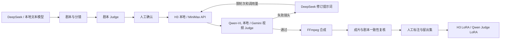

# Lululian Short｜工业级可迭代 AI 短剧

**工业级可迭代 AI 短剧创作系统：双 Judge、自动返修、模型微调、本地／API 双模式。**

项目围绕剧本、角色、分镜、视频生成、双重 Judge 和反馈训练构建制作闭环，支持本地模型与云端 API。目标是让每轮创作都有明确输入、可检查的产物、可追踪的评审和可控制的返修成本。

> 当前为 V2 / v0.2.0 工程开发版。功能已接入，真实 GPU 模型运行、付费 API 端到端调用与生产负载仍需验收。下面明确区分功能和验证边界。

[版本更新记录（V1 → V2）](CHANGELOG.md) · [模型助手与反馈调优](docs/agents.md)

## V2 新增

- 四阶段前端控制：剧本生产、剧本 Judge、视频生产、视频 Judge。
- 网页模型配置助手：云端／本地／混合方案，自动填写接口、检测凭据、选择模型和有限重试。
- 人工反馈调优：手动优化提示词、选择满意或不满意、比较 Agent 提案，采用后重生成并再次反馈。
- Agent 仅限模型操作：没有代码编辑、终端、Git 或任意工具执行能力；版本、锁定和调用上限由后端检查。

## 启动

需要 Python 3.11+、Node.js 22+、uv 和 FFmpeg。

```bash
uv sync
npm --prefix frontend ci
npm --prefix frontend run build
uv run uvicorn lululian.main:app --app-dir backend --host 127.0.0.1 --port 8000
```

访问 http://127.0.0.1:8000 。API 文档位于 `/docs`。

开发时分别启动后端和前端：`npm --prefix frontend run dev`，打开 http://127.0.0.1:5173 。

## 制作流程

1. 创建作品，填写创意、题材、风格、画幅与集数。
2. 生成剧本、角色与分镜，手动修改内容。
3. 运行剧本 Judge，查看问题并人工确认当前版本。
4. 生成或上传画面与配音；可锁定镜头、调整顺序、单镜重做。
5. 检查素材，按集导出带字幕的 MP4、SRT 和项目 JSON。

修改创作内容会使原确认失效，需要重新评审。素材生成失败会保存之前完成的镜头，重试默认只补齐缺失素材。

## 模型设置

默认演示模式不使用外部模型：固定示例故事、明确标注的占位画面、规则检查，无假配音或假 AI 评分。

在「模型设置」中配置文本、图片、配音与独立剧本 Judge 的 API 地址、模型名称、密钥。文本可连接 DeepSeek 或兼容 Chat Completions 的本地服务。配置后切换真实模式。不同服务商对生图与配音参数的支持可能不同。

密钥写入本机 `.data/settings.json`（权限 0600），不回传到前端。也可通过 `.env.example` 所列环境变量配置；界面保存的设置优先。数据库、密钥、生成素材均排除在 Git 之外。

## 技术与边界

- React + TypeScript + Vite 中文工作台。
- FastAPI + SQLite WAL 项目与任务存储。
- 每个项目同时只运行一个任务；文件逐镜保存，程序重启将中断任务标记为失败，等待人工重试。
- FFmpeg 合成 H.264/AAC；Pillow 绘制字幕，独立导出 SRT。
- 第一版以单机、单用户、单后端进程为部署边界；不要启用多个 Uvicorn worker，也不要直接暴露公网。
- 规则检查不是语义模型评审，技术素材检查不是视频内容 Judge。

## 验证

```bash
uv run pytest
uv run ruff check backend
npm --prefix frontend run build
```

真实模型调用需要自行配置密钥或部署模型。仓库不包含任何训练权重、密钥或用户素材。


## 双模式模型流水线



编剧、剧本评审、视频生成、视频评审各自独立配置。视频 Judge 输入实际视频与分镜，返回评分、判定、问题时间段、可观察证据和修改建议。Qwen-VL 路径仅评视觉；Gemini 路径提供音视频输入。不确定判断不会自动当成通过。

自动返修以已确认剧本为前提，不会偷偷改变故事来迎合评分。每轮保留旧视频、修订提示词、评审结果和调用记录。达到轮次、调用上限或锁定镜头失败后停止，等待人工处理。

## 能力与验证状态

| 模块 | 实现 | 验证边界 |
| --- | --- | --- |
| 中文工作台 | 项目、角色、分镜、素材上传、设置、任务进度 | TypeScript 构建与浏览器流程检查 |
| 剧本 Judge | 独立模型、规则检查、版本确认 | 本地自动测试；真实模型需配置 |
| 视频 Judge | Qwen-VL 视频 data URL / Gemini 原生视频输入 | 契约测试；真实 GPU/API 待验收 |
| H3 生成 | SGLang 本地 / MiniMax v2 API，保存任务 ID | 模拟服务测试；真实生成待验收 |
| 自动返修 | 逐镜评审、提示词修订、限次重做、成片复核 | 使用可控 fake provider 测试通过/失败路径 |
| 成片 | H.264 MP4、字幕、SRT、原视频音轨或独立配音 | 本地 FFmpeg 实际合成测试 |
| 训练 | H3 LoRA 编排、Qwen Judge LoRA SFT、数据划分和评测 | CPU 数据测试与 dry run；未声称训练完成 |

[部署指南](docs/deployment.md) · [训练与迭代](training/README.md)

工业级是工程方向，不是已通过大规模生产验收的承诺。本版尚无多租户权限、分布式队列、集群高可用或服务 SLA，默认面向单用户本地制作。适合先建立可复现的制作与评审基线，再按负载扩展。

## 联系方式

联系邮箱：[lululian2026@126.com](mailto:lululian2026@126.com)。
