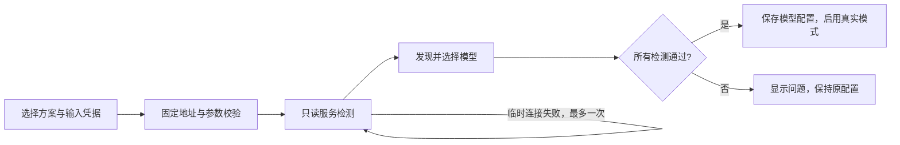

# 模型控制与人工反馈

本页说明 V2 的模型操作边界。仓库版本历史见 [CHANGELOG](../CHANGELOG.md)。

## 四阶段控制台

进入作品默认打开「流水线控制台」。剧本生产与剧本 Judge 面向全项目；视频生产与视频 Judge 按当前选择的剧集或镜头执行。四类操作复用任务队列，单项目同时只运行一个任务。

1. 在「故事剧本」编辑创意和集数，保存后启动剧本生产。
2. 启动剧本 Judge，阅读意见，手动修改后重新评审；确认当前剧本再进入制作。
3. 选择剧集及制作步骤，生成图片、配音、视频或合成成片。默认只补齐缺失素材。
4. 选择本集镜头、单镜头或成片评审。整集成片必须对应当前项目版本。

自动制作与返修可在第 3 / 4 阶段展开设置；它从已确认剧本出发。锁定镜头失败、Judge 不确定、预算耗尽或成片复核失败都会停止，保留记录。

## 配置助手 Loop

网页「模型设置」顶部提供三种方案：云端（DeepSeek + Gemini + MiniMax）、混合（DeepSeek + 本地视频模型）、本地（本地文本 + Qwen-VL + H3）。本地服务需提前部署，助手不会安装软件或启动终端。

用户填写 Key；留空仅复用相同地址已保存的 Key。模型名可选，留空时从返回的模型目录中筛选候选；可指定模型覆盖自动选择。本地端口可配置，宿主地址仅允许回环地址或 Docker 宿主别名。

检测只调用服务的模型列表或 MiniMax 任务列表，不提交生成任务。服务商响应不直接展示，记录只含脱敏状态、模型 ID 和固定地址。读取任务列表不会保存或返回账户已有视频内容。配置任务独立于作品任务，运行中禁止修改设置或新建制作任务。

这是一套确定性的受限配置状态机，不会把密钥交给大语言模型规划。检测成功只代表目录/只读接口可访问，不保证具体模型支持视频输入或账户具备生成额度。需用实际制作任务验收。

## 人工反馈 Prompt Agent Loop

在视频生产或视频 Judge 页的「人工反馈 → 提示词调优」区域：

1. 选择已有视频的镜头，观看实际结果。
2. 编辑提示词，填写具体问题或满意的原因。
3. 选择「满意，记录偏好」，或在真实模式下选择「不满意，提交并调优」。
4. 选择「人工修改」或「Agent 总结标注后调优」。Agent 可选择使用 0–50 条历史人工标注（默认 8 条），当前反馈始终另外使用；历史仅选同镜头、同一剧本内容、早于当前反馈的记录，不足按实际条数处理。
5. Agent 先总结通过样本的保留特征、不通过样本的问题及下一轮优化规则，再结合当前剧本输出严格的提示词提案。页面展示总结及通过／不通过的实际数量。满意映射为通过，不满意映射为不通过，这些是人的标注，不是模型自行认定的真值。
6. 对比人工版本和 Agent 提案，选择采用。采用前检查项目版本、剧本确认、镜头锁定和运行任务；不满足条件不会写入。
7. 点击「用当前提示词重生成」，观看新视频，再次给出反馈。

每条反馈最多发起 3 次调优，每轮最多两次文本模型调用（标注总结 + 提示词优化）；失败也计次。标注文本超过 80000 字符时在模型调用前拒绝，并提示减少条数，不会静默截断。选取的反馈 ID、请求数量、实际数量和总结保存在任务事件中。历史提案与调用保存在任务结果和事件中。采用提案只更新镜头的视频提示词，增加项目版本并记录采用来源，原视频不会被立即覆盖。已有视频并不意味着它已按新提示词重做，需明确点击重生成。

满意反馈是提示词优化参考，不等于人工确认的新视频已经生成，也不自动进入模型训练。训练数据仍走独立的数据准备与人工确认流程。

## 模块职责

| 模块 | 职责 | 不负责 |
| --- | --- | --- |
| `model_agent.py` | 有界配置状态机、固定只读检测、配置保存 | 代码执行、生成视频、读取任意文件 |
| `feedback.py` | 版本化反馈、快照、原子采用提案 | 调用模型、生成内容 |
| `prompt_agent.py` | 用反馈生成严格类型的提示词提案 | 应用提案、改剧本、改 API 设置 |
| `production_contracts.py` | 剧本与镜头的共享输入结构 | 存储、网络请求或任务调度 |
| `jobs.py` | 任务状态、调优次数上限、模型调用编排 | 决定人工满意度 |
| `agent_routes.py` | 固定 HTTP 能力入口与参数校验 | 动态注册工具或执行任意指令 |
| 前端三个独立面板 | 阶段控制、配置向导、反馈比较 | 持有后端长期密钥、直接操作源码 |

后端没有为这些 Agent 暴露 shell、Python 执行器、文件编辑器、Git 或通用 URL 请求工具。模型输出中的额外工具/命令字段会被拒绝，纯文本中的指令不会执行。该边界是应用的能力限制，不等于后端操作系统进程已经沙箱隔离；工作台仍按部署文档限定为可信的本机单用户应用。

## 故障恢复

- 配置记录与反馈保存在 SQLite；配置中途停止或后端重启，不自动采用未完成的检测方案。
- 文本调优失败时原提示词不变，可查看任务消息后在剩余次数内重试。
- 制作失败保留已完成素材；本版没有分布式或跨进程执行恢复。
- 页面刷新可重新读取记录；未提交的反馈输入不持久化。密钥仅在配置成功时写入服务器设置，失败后刷新页面需重新输入未保存的 Key。
